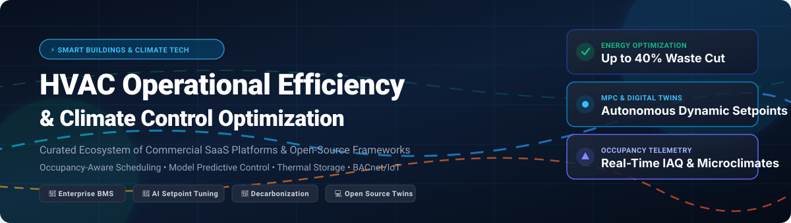

# Awesome HVAC Operational Efficiency Optimization 🏢⚡❄️

  

  
  
  
  
  
  
  

---

> 🌟 **A curated directory of commercial SaaS platforms, AI-driven climate control tools, and open-source frameworks engineered to maximize HVAC operational efficiency, building energy conservation, occupancy-aware scheduling, and smart decarbonization.**

HVAC systems account for roughly **40% to 50% of commercial building energy consumption**. This repository catalogs industry-proven software platforms and self-hosted tools that leverage Model Predictive Control (MPC), dynamic occupancy sensing, thermal energy modeling, BACnet/Modbus telemetry, and real-time setpoint optimization to cut waste without sacrificing human comfort.

---

## 📑 Table of Contents

- [📊 Sector Overview & Market Dynamics](#-sector-overview--market-dynamics)
- [🏢 SaaS & Hosted Commercial Platforms](#-saas--hosted-commercial-platforms)
- [💻 Open-Source GitHub Projects](#-open-source-github-projects)
- [🔍 Key Technological Levers for HVAC Efficiency](#-key-technological-levers-for-hvac-efficiency)
- [🤝 How to Contribute](#-how-to-contribute)
- [📈 Star History](#-star-history)
- [💖 Support](#-support)
- [⚖️ Disclaimer & Standards Compliance](#-disclaimer--standards-compliance)

---

## 📊 Sector Overview & Market Dynamics

The global HVAC systems and smart building energy management sector was valued at approximately **$240 billion to $280 billion**, with smart building operational software and HVAC optimization expanding rapidly at a CAGR of 11.2% driven by net-zero mandates, dynamic grid tariffs, and rising corporate ESG standards.

The market displays a **bifurcated, moderately fragmented ecosystem**: legacy industrial hardware and Building Automation Systems (BAS) remain concentrated among established multi-billion dollar conglomerates (Honeywell, Siemens, Schneider Electric, Johnson Controls, Carrier, Trane, ABB, Daikin), while the cloud-native AI setpoint optimization and occupancy analytics layer features intense competition from specialized pure-play innovators (such as BrainBox AI, 75F, and Augury), making standard vendor-agnostic protocols (BACnet, MQTT, Brick Schema) critical for ecosystem interoperability.

---

## 🏢 SaaS & Hosted Commercial Platforms

Below is a detailed comparison of market-leading enterprise SaaS and cloud platforms for HVAC operational efficiency, sorted by company revenue/valuation scale (descending).

| Platform | Company Valuation / Revenue | Pricing (Starting Tier) | Free Tier / Trial Limits | Key Optimization Capabilities & Focus |
|:---|:---|:---|:---|:---|
| **[Siemens Building X](https://www.siemens.com/)** | ~$85.5B / €78.9B Annual Rev | From €150/month per building gateway connector (Operations & Energy Manager base tier) | 30-day full feature trial with live telemetry sandbox & demo building digital twin | Unified operations suite preserving lifecycle BIM data, closed-loop thermal analytics, AI setpoint tuning, and predictive chiller fault detection. |
| **[Schneider Electric EcoStruxure Building Activate](https://www.se.com/uk/en/about-us/newsroom/news/press-releases/schneider-electric-introduces-ecostruxure%E2%84%A2-building-activate-simplifying-automated-management-for-small-and-mid-size-buildings-674df5f8886e15832a0cc1b7/)** | ~$40.6B / €37.5B Annual Rev | From $120/month per site (Activate Small/Mid-size commercial base tier) | 30-day free proof-of-concept trial covering up to 2 gateway controllers and 50 data points | Cloud-native BMS reducing energy demand up to 48% and operational carbon up to 60%; proven 15% energy cut with &lt;12 month payback. |
| **[Honeywell Forge for Buildings](https://www.honeywell.com/)** | ~$38.5B Annual Rev | From $250/month per facility (Core Energy & Asset Performance SaaS tier) | 30-day interactive cloud trial with sample facility dataset and API evaluation keys | Autonomous predictive control, indoor air quality (IAQ) vs energy balancing, chiller plant automated sequencing, and enterprise multi-site management. |
| **[ABB Ability BuildingPro Suites](https://new.abb.com/news/detail/134002/abb-launches-ability-buildingpro-suites-to-unify-building-and-iot-systems-for-data-driven-performance)** | ~$32.8B Annual Rev | From $95/month per connected building edge node (Energy & Operations starter suite) | 60-day trial for ABB Cylon/BuildingPro edge gateway users with up to 100 BACnet points | Open semantic data model platform integrating BACnet, KNX, Modbus, and MQTT with autonomous edge-to-cloud load curtailment and space analytics. |
| **[Daikin One Cloud](https://www.daikin.com/)** | ~$28.4B / ¥4.4T Annual Rev | Free bundled for Daikin smart thermostats; Pro Commercial monitoring from $15/device/month | Free lifetime tier for single-thermostat basic scheduling & consumer app; 30-day pro commercial trial | Direct OEM equipment telemetry, automated inverter compressor modulation, refrigerant cycle fault alerts, and geofenced setback scheduling. |
| **[Johnson Controls OpenBlue](https://www.johnsoncontrols.com/)** | ~$27.3B Annual Rev | From $180/month per building (OpenBlue Enterprise Manager base subscription) | 30-day guided proof-of-value sandbox for qualified commercial facilities | AI-powered chiller plant optimization, central plant staging, automated demand response (ADR), and deep integration into legacy Metasys installations. |
| **[Carrier Abound](https://www.carrier.com/)** | ~$22.5B Annual Rev | From $110/month per facility (IAQ & Basic Energy Performance module) | 30-day pilot trial for up to 10 IoT environmental sensors and 1 HVAC equipment gateway | Cloud intelligence delivering real-time indoor environmental quality (IEQ) benchmarking, ASHRAE standard compliance monitoring, and automated fan speed curves. |
| **[Trane Cloud / ARIA AI](https://www.facilitiesdive.com/news/trane-launches-digital-hub-to-unify-building-data-applications/811717/)** | ~$19.8B Annual Rev (Trane Technologies) | From $140/month per controller (Trane Connect & ARIA autonomous control tier) | 30-day trial with Trane Connect virtual simulator and pre-configured chiller plants | ARIA AI autonomous HVAC control driving up to 25% heating/cooling reduction and 40% carbon savings across institutional and commercial facilities. |
| **[75F Dynamic Airflow Balancing](https://www.75f.io/)** | ~$150M Valuation (Growth Stage) | From $35/month per zone controller or $0.12/sq. ft./year subscription | 30-day risk-free hardware trial with 1 Central Control Unit (CCU) and 4 smart dampers | Vertically integrated IoT dampers, smart wireless sensors, and predictive cloud algorithms for proactive solar gain and airflow modulation. |
| **[BrainBox AI](https://brainboxai.com/)** | ~$120M Valuation (Series B) | From $0.06/sq. ft./year (starting ~$300/month for average 60,000 sq. ft. commercial building) | 60-day zero-capex autonomous HVAC pilot with guaranteed 10%+ energy reduction baseline test | Deep learning artificial intelligence connecting directly to existing BACnet systems; modulates setpoints every 2.5 minutes using predictive weather & thermal models. |

---

## 💻 Open-Source GitHub Projects

Explore open-source building simulation engines, autonomous reinforcement learning controllers, and production-grade Energy Management Systems (EMS). Ranked by GitHub stars (descending):

| Repository | Stars | License | Primary Focus & Domain |
|:---|:---:|:---:|:---|
| **[pymodbus-dev/pymodbus](https://github.com/pymodbus-dev/pymodbus)** |  | BSD-3-Clause | Python implementation of Modbus protocol stack (TCP/RTU/ASCII) for direct HVAC sensor/actuator fieldbus telemetry and hardware control. |
| **[NREL/EnergyPlus](https://github.com/NREL/EnergyPlus)** |  | Modified BSD | The world's flagship whole-building energy simulation engine for modeling heating, cooling, lighting, ventilation, and water heating energy flows. |
| **[myems/myems](https://github.com/myems/myems)** |  | Apache-2.0 | Full-featured, enterprise-grade open-source Energy Management System (EMS) for commercial facilities, campus microgrids, and HVAC equipment telemetry. |
| **[NREL/OpenStudio](https://github.com/NREL/OpenStudio)** |  | Modified BSD | Cross-platform software development kit (SDK) supporting whole-building energy modeling, parametric analysis, and automated HVAC lifecycle optimization. |
| **[intelligent-environments-lab/CityLearn](https://github.com/intelligent-environments-lab/CityLearn)** |  | MIT | Gymnasium environment for benchmarking Multi-Agent Reinforcement Learning (MARL) for demand response, HVAC control, and city-scale thermal storage. |
| **[VOLTTRON/volttron](https://github.com/VOLTTRON/volttron)** |  | Apache-2.0 | DOE/PNNL multi-agent platform for IoT and building automation; orchestrates real-time sensor ingestion, BACnet dispatch, and autonomous grid interaction. |
| **[lbl-srg/modelica-buildings](https://github.com/lbl-srg/modelica-buildings)** |  | BSD-3-Clause | Premier dynamic simulation library (LBNL) for HVAC systems, heat pumps, ASHRAE Guideline 36 advanced control sequences, and district energy loops. |
| **[ChristianTremblay/BAC0](https://github.com/ChristianTremblay/BAC0)** |  | MIT | Python scripting library connecting directly to BACnet/IP building networks to read live sensor points, trend time-series logs, and override actuator setpoints. |
| **[ugr-sail/sinergym](https://github.com/ugr-sail/sinergym)** |  | MIT | Gymnasium environment for building energy control research with EnergyPlus, enabling effortless benchmarking of Deep RL agents on HVAC control problems. |
| **[ibpsa/project1-boptest](https://github.com/ibpsa/project1-boptest)** |  | BSD-3-Clause | Building Optimization Performance Test framework developed by IBPSA for standardized benchmarking of advanced control algorithms (MPC and RL). |
| **[mechyai/RL-EmsPy](https://github.com/mechyai/RL-EmsPy)** |  | MIT | Python API connecting reinforcement learning agents directly to the EnergyPlus Energy Management System (EMS) runtime engine for customized HVAC controls. |
| **[rdnfn/beobench](https://github.com/rdnfn/beobench)** |  | MIT | Unified benchmark and containerized execution environment for evaluating reinforcement learning policies on simulated HVAC and thermal building models. |
| **[HIT2GAP-EU-PROJECT/bemserver](https://github.com/HIT2GAP-EU-PROJECT/bemserver)** |  | Apache-2.0 | EU HIT2GAP operational building energy platform; centralizes BMS heterogeneous telemetry, semantic models, and automated fault detection & diagnosis (FDD). |
| **[PSMRB/dfl_hvac_management](https://github.com/PSMRB/dfl_hvac_management)** |  | MIT | Decision-Focused Learning (DFL) framework for commercial HVAC scheduling, training end-to-end neural surrogate models to minimize peak electricity cost. |
| **[BangyStudios/ACAI](https://github.com/BangyStudios/ACAI)** |  | MIT | Lightweight AI suite designed to minimize residential and light commercial air conditioning consumption using volume-aware airflow and solar integration. |
| **[sustainable-computing/ocft](https://github.com/sustainable-computing/ocft)** |  | MIT | Online comfort-constrained feature-transfer RL policy delivering an 81.2% drop in thermal comfort violations with only an 11.2% change in energy expenditure. |
| **[VOLTTRON/volttron-pnnl-aems](https://github.com/VOLTTRON/volttron-pnnl-aems)** |  | Apache-2.0 | Autonomous Energy Management Software for rooftop units (RTUs), heat pumps, and distributed energy resources developed by Pacific Northwest National Laboratory. |
| **[SmithRWORNL/ACTIVE](https://github.com/SmithRWORNL/ACTIVE)** |  | BSD-3-Clause | Automated Control Testbed for Integration, Verification, and Emulation (ORNL) supporting the end-to-end lifecycle of advanced supervisory HVAC controllers. |

---

## 🔍 Key Technological Levers for HVAC Efficiency

1. **Model Predictive Control (MPC)**: Utilizes multi-hour thermal models, weather forecast feeds, and pricing signals to pre-cool or pre-heat buildings during low-cost utility windows.
2. **Dynamic Occupancy Sensing**: Automatically throttles Variable Air Volume (VAV) terminal boxes and outdoor air dampers during low density, avoiding conditioned air waste in empty zones.
3. **Automated Fault Detection & Diagnostics (FDD)**: Detects stuck dampers, leaking heating coils, cycling compressors, and sensor drift before equipment degrades or energy bills spike.
4. **ASHRAE Guideline 36 High-Performance Sequences**: Implements standardized reset strategies for static duct pressure and supply air temperature based on real-time zone feedback.
5. **Chiller Plant Optimization**: Dynamically sequences chillers, cooling towers, and variable primary pumps to run at optimal Coefficient of Performance (COP) curves.

---

## 🤝 How to Contribute

Contributions to this ecosystem are warmly welcomed! 🚀

1. 🍴 Fork the repository.
2. 🌿 Create a new feature branch (`git checkout -b feature/add-new-tool`).
3. 📝 Update `README.md` with:
   - Platform / Repository Name and canonical URL.
   - Pricing tier and trial terms (for SaaS).
   - GitHub stars badge linked to stargazers and license (for open-source).
   - Concise summary of operational HVAC efficiency features.
4. 🚀 Commit your improvements (`git commit -m "Add New HVAC Optimization Tool"`).
5. 📬 Open a Pull Request detailing your additions.

---

## 📈 Star History

---

## 💖 Support

If you find this curated collection valuable for your building engineering projects, facilities management, or energy research:

- ⭐ **Star this repository** to help others discover it!
- 🍴 **Fork the repo** to contribute your own algorithms, tools, or real-world case studies.
- 📣 **Share** with your fellow MEP engineers, building automation specialists, and climate tech developers.
- ☕ **Buy me a coffee**: If you'd like to support ongoing maintenance and research, visit the **[GitHub Sponsors Dashboard](https://github.com/sponsors/ishandutta2007)**. Thank you for your support!

---

## ⚖️ Disclaimer & Standards Compliance

- This repository is an independent, community-maintained collection and is not directly affiliated with any manufacturer, consortium, or laboratory mentioned.
- Any automated supervisory control sequence deployed in a physical facility must adhere to relevant local life-safety codes, ASHRAE Standards (such as Standard 55 for Thermal Environmental Conditions, Standard 62.1 for Ventilation and Acceptable Indoor Air Quality, and Standard 90.1 for Energy Efficiency), and manufacturer equipment operating boundaries.
- Open-source and third-party AI controllers should always feature automated fail-safe fallbacks to factory thermostat and BMS safety limits.

---

  <b>Built for facility managers, building engineers, and developers accelerating sustainable, data-driven climate control. 🌍❄️🔥</b>

